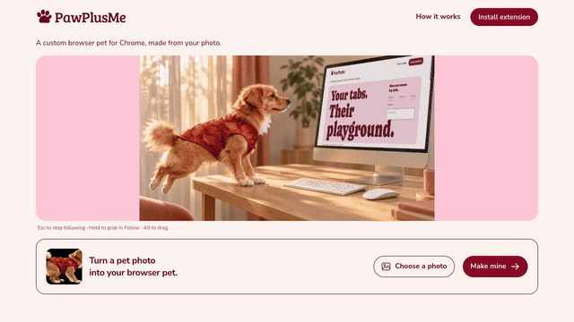

# PawPlusMe browser pet

An animated companion for Chrome, made from your photo. It watches your pointer,
follows you across ordinary web pages, naps, reacts to typing and brings a playful
reminder when your focus timer ends.

**[Try the live demo or create your pet](https://www.pawplusme.com/?utm_source=github&utm_medium=referral&utm_campaign=opensource)** ·
[How it works](https://www.pawplusme.com/how-it-works) ·
[Pricing](https://www.pawplusme.com/pricing)

This repository contains the complete Manifest V3 extension and its shared
animation runtime. Photo generation, checkout and the hosted website are separate
services. The extension does not include a sample pet: create or recover your pet
on PawPlusMe, then choose **Bring it to my browser** to claim it.



The demonstration includes a cinematic opening followed by website interaction.
It shows the product experience, rather than an extension installation walkthrough.

## What it does

- Watch your pointer, follow it with directional animation, or sleep quietly.
- Interact around existing text fields without reading their contents.
- Keep multiple claimed pets and switch between them locally.
- Customize action shortcuts, resize, hide and recall your companion.
- Set a focus timer that survives tab changes and browser worker restarts.

Once claimed, the pet's cached assets and ordinary interactions work locally.
Browser settings, restricted pages and Chrome's internal pages may prevent an
extension from appearing.

## Install

For the current official installation instructions, visit
[PawPlusMe's installation guide](https://www.pawplusme.com/how-it-works#install).
GitHub releases and Chrome Web Store publication are separate release channels.

To load a GitHub release manually:

1. Download `pawplusme-extension-<version>.zip` from this repository's Releases
   and extract it to a permanent folder.
2. Open `chrome://extensions`, enable **Developer mode**, select **Load unpacked**
   and choose the extracted folder containing `manifest.json`.
3. Open PawPlusMe in the same Chrome profile. Create or recover a pet and claim it.
4. Open or refresh an ordinary HTTP or HTTPS page. Use the extension popup to
   switch modes, set a timer or recall the pet.

The extension starts with an empty pet library. Installing it does not create a
pet or purchase generation. Current generation availability and prices are shown
on the website.

## Develop

Use Node.js 22 or later. Browser code has no runtime package dependencies.

```sh
npm ci
npm run check
npm test
npm run build
```

Load `dist/extension` as an unpacked extension. The default build connects to
`https://www.pawplusme.com` and requires an existing or newly created website pet
for interactive testing. Tests use fake assets and never purchase or generate a
pet.

```sh
npm run build:dev
npm run build -- --origin https://preview.example.com
```

The development build connects to `http://127.0.0.1:4318`. It expects a compatible
local website service, which is not included here. `--origin` creates a package
for an explicitly supplied HTTPS preview website. An explicit loopback origin
with another local port, such as `http://127.0.0.1:4391`, is also supported for
local development; public HTTP origins are rejected.

| Directory | Purpose |
| --- | --- |
| `src/extension` | Background worker, popup, page bridge and manifest template |
| `src/shared` | Shared pet behavior, geometry, timer, shortcuts and translations |
| `assets` | Icons, fonts and original font notices |
| `scripts` | Portable build, archive and package checks |
| `test` | Packaged-code tests with synthetic fixtures |
| `dist` | Generated extension, runtime and source packages; not source files |

Make shared behavior changes in `src/shared`. Do not edit generated files in
`dist`. The website consumes a pinned release of these files; it does not maintain
another editable runtime copy.

## Permissions and privacy

The extension requests `storage` to keep preferences and the active pet, and
`alarms` to restore focus reminders. The pet library also uses local IndexedDB.

Content scripts run on ordinary HTTP and HTTPS pages so the pet can appear after
navigation and respond to local pointer events and element geometry. This broad
matching is required for automatic cross-page companionship. It does not grant
network access to every website.

The scripts do not upload page text, form values or browsing activity. Pointer,
keyboard and layout events used by interactions stay in the page. Claiming a pet
contacts the configured PawPlusMe website for an authorization ticket, an asset
manifest and a PNG sprite sheet. Opening the creation page is an intentional
website visit; the website's own service and analytics policies apply.

See the [extension privacy policy](https://www.pawplusme.com/privacy#chrome-extension-privacy)
and [local development notes](docs/development.md). Please do not attach private
claim links, recovery links or photographs to public issues.

## Releases and contributions

Release archives contain `manifest.json` at their root. Releases include SHA256
checksums, the shared runtime bundle and a portable source bundle for consumers
that build against their own website origin. Source tags, GitHub releases and
Chrome Web Store releases should be matched explicitly; a GitHub release does not
mean that Chrome Web Store review has completed.

Read [CONTRIBUTING.md](CONTRIBUTING.md) for checks and pull requests, or
[SECURITY.md](SECURITY.md) to report a vulnerability privately.

## License

Code is available under the [MIT License](LICENSE). Fonts retain their original
licenses; see [THIRD_PARTY_NOTICES.md](THIRD_PARTY_NOTICES.md).
